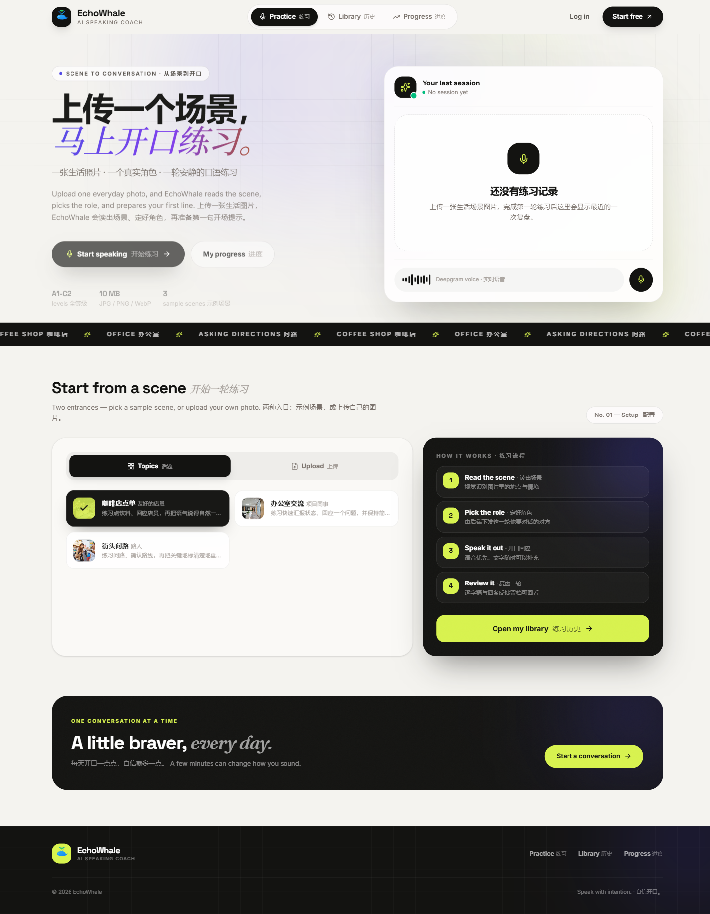
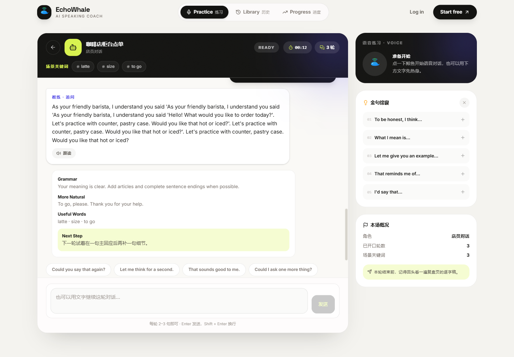
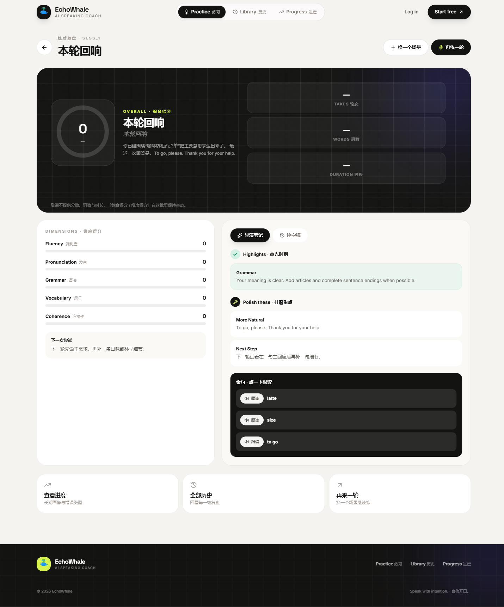
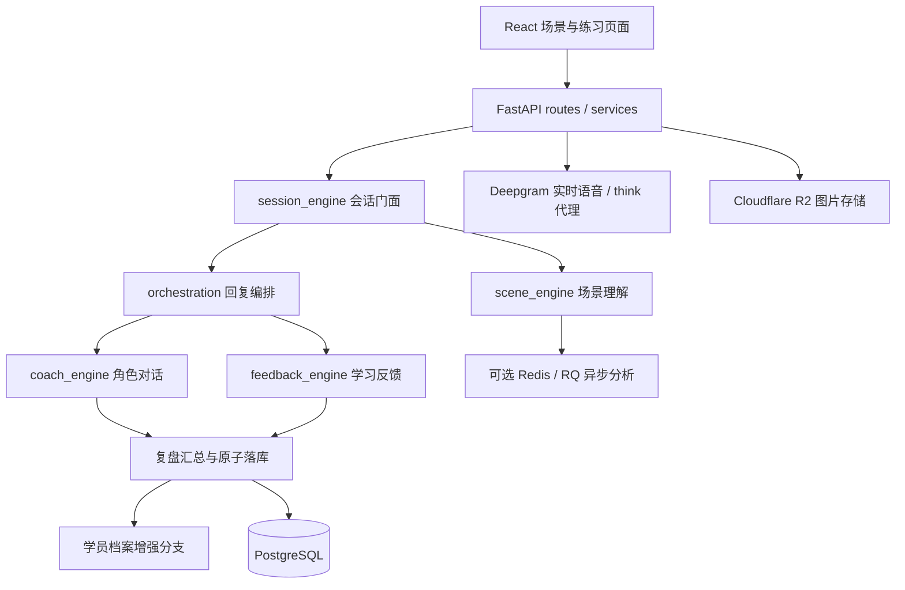

# EchoWhale

**图片驱动的英语情景陪练，支持实时语音、即时反馈与学习复盘。**

把生活照片变成英语练习：上传图片，或选择咖啡店、办公室、街头问路等示例场景，与场景中的角色对话。每轮获得语法纠错、自然表达与词汇建议，练习后回看复盘；登录后还可查看历史和个人学习进度。

[](https://github.com/ZT1314888/EchoWhale/actions/workflows/ci.yml)
[](LICENSE)

## 界面预览

新版界面采用暖色背景与卡片布局，覆盖场景创作、对话练习与复盘概览，采用响应式布局。375px 手机首页仍有横向溢出，详见发布记录。
以下为真实应用页面截图，使用独立临时数据库与内置 mock provider 的演示数据，不代表真实模型或语音评测结果。

### 选择场景



### 对话与即时反馈



### 学习复盘



## 核心体验

- **从图片进入情境**：识别场景、角色与视觉锚点；也可用内置示例直接开始。
- **文字与实时语音**：文字回复通过 SSE 逐段呈现；Deepgram 实时语音 Agent 支持听写与对话收口。语音需单独配置服务，不提供发音评分。
- **每轮可用的反馈**：语法纠错、更自然表达、场景词汇与下一步建议。
- **复盘与成长记录**：练习复盘、认证用户历史分页与学习档案；根据练习更新 CEFR 估计、常见错误与场景频次。

当前边界：文字练习尚无直接进入复盘的按钮，可访问 `/session/<id>/review`；复盘逐字稿依赖登录后的历史接口，匿名用户无法读取。截图展示的是可用的复盘概览。

## 已实现架构

React 19 / TypeScript / Vite 6 / Tailwind CSS 4 前端，通过 FastAPI 应用服务访问模块化引擎。Python 3.12+、SQLAlchemy 与 Alembic 管理持久化；生产数据库为 PostgreSQL。



教练与反馈并发执行，由协议与注册表组织协作；复盘和档案属于增强分支，失败策略与诊断集中管理。视觉、文本模型支持 OpenAI 兼容接口及主备通道，提供离线评测工具。可选 OpenTelemetry 记录 API、编排和引擎三层 span。

Docker 镜像与 compose 参考配置已提供。CI 包含 SQLite 后端、PostgreSQL 平价与迁移往返、前端质量门禁、Docker 构建四个 job；镜像当前只构建，不自动推送或部署。**尚未配置 CD。** Terraform 与 Cloudflare 自动部署不属于已实现交付能力。

## 本地启动

需要 Python 3.12+、[uv](https://docs.astral.sh/uv/)、Node.js 22.13+、PostgreSQL 与 Redis。Node 要求对齐 ESLint 10；依赖以 npm 和 `frontend/package-lock.json` 为准。

```bash
git clone https://github.com/ZT1314888/EchoWhale.git
cd EchoWhale
cp .env.example .env
uv sync --frozen
```

编辑 `.env`，至少配置可连接的 `DATABASE_URL`、`REDIS_URL`。默认 `MODEL_RUNTIME_MODE=mock` 可体验示例文字练习，无需模型密钥；图片上传需要 R2，真实模型、语音和认证邮件分别需要对应服务配置。不要将密钥提交到仓库。

先执行迁移，再启动后端：

```bash
uv run alembic upgrade head
uv run uvicorn api.main:app --reload --port 8001
```

另开终端启动前端：

```bash
cd frontend
npm ci
npm run dev
```

日常也可用 `pnpm dev` 启动已有依赖，不维护第二份锁文件。Windows PowerShell 复制配置可用 `Copy-Item .env.example .env`。

打开 [前端](http://localhost:5173)、[API 文档](http://localhost:8001/docs) 或 [健康检查](http://localhost:8001/health)。Vite 将 `/api` 代理到 `http://localhost:8001`，可用 `VITE_API_PROXY_TARGET` 指定地址。

## 验证与文档

```bash
# 后端：CI 为测试进程设置 60 秒硬超时
uv run pytest tests --cov=api
uv run ruff check api tests tools
uv run black --check api tests tools
uv run python -m tools.agent_ops check

# 前端（在 frontend/ 下）
npm run coverage
npm run lint
npm run typecheck
npm run build
```

| 文档 | 内容 |
| --- | --- |
| [产品需求](docs/prd.md) | 产品当前形态、范围与用户流程 |
| [API 参考](docs/api.md) | 身份、错误码、SSE、轮询与历史分页 |
| [部署手册](docs/deployment.md) | 环境配置、Docker、迁移与回滚 |
| [可观测性](docs/observability.md) | OTel span 与导出配置 |
| [历史审计](docs/audits/README.md) | 2026 年 10 月的审计快照及适用范围 |
| [本次发布记录](docs/features/repository_publish_refresh/feature.md) | 验证、已知边界与 PR/CI 证据 |
| [项目工作台](docs/control/project-index.md) | 模块归属、状态与治理入口 |

目录：`api/` 后端与引擎，`frontend/` 页面与组件，`tests/` 后端回归，`infra/docker/` 容器交付，`tools/` 评测和治理工具，`docs/` 产品与工程记录。

贡献前请阅读 [AGENTS.md](AGENTS.md) 与[治理协议](docs/control/agent-governance.md)，在文档中记录模块归属、验证结果与变更范围。

本项目采用 [MIT License](LICENSE)。
